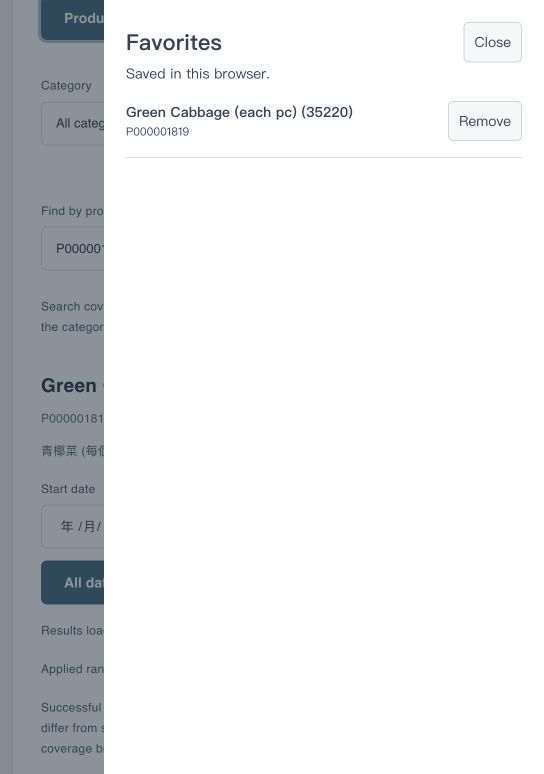

# PriceWatch

PriceWatch is a local web application for comparing Hong Kong everyday-product prices across merchants. It combines the latest successful price collection with category comparison, price-history analysis, explicit multi-buy calculations, product favorites, and merchant logos.


## What the application provides

- **Current Prices** — search by product name, brand, or product code and compare the latest valid merchant quotes.
- **Category Insights** — compare two merchants using the same product-code sample, show ties and missing quotes correctly, rank price differences, and calculate only clearly interpretable quantity offers.
- **Price History** — inspect historical quotes, period minima, recent changes, and merchant trends across successful collection batches.
- **Favorites** — save a product from a product-detail, category, or history view and manage the shared browser-local list from the Favorites entry.
- **Bilingual display** — preserve the source Chinese/English product information while avoiding duplicate text and repairing unit-only names when a reliable brand field is available.
- **Responsive layout** — tables remain readable on narrow screens through horizontal scrolling and accessible focus states.

## Screenshots

### Favorites on a narrow screen



The repository also includes the original grocery landing image used by the application. Runtime merchant logos are stored in [`assets/merchant-logos`](assets/merchant-logos).

## Architecture

```text
Official pricewatch JSON
          │
          ▼
   Node-RED collection flow
          │ normalise and validate
          ▼
       MongoDB
   ┌──────┼─────────┐
   ▼      ▼         ▼
Current  Category  History
Prices   Insights  analysis
   └──────┼─────────┘
          ▼
  Browser-local Favorites
```

The system is intentionally local. Node-RED and MongoDB communicate through the Docker network `comp7503-net`; the browser talks to Node-RED at `http://localhost:1880`.

## Technology

- Docker Desktop
- Node-RED
- FlowFuse Node-RED Dashboard (`@flowfuse/node-red-dashboard`)
- MongoDB 8
- `node-red-contrib-mongodb4`
- Vue templates embedded in Dashboard UI nodes
- Hong Kong timezone: `Asia/Hong_Kong`

## Quick start on macOS

### 1. Start Docker services

If the services do not already exist, run:

```bash
docker network create comp7503-net
docker run -d --name comp7503-mongo \
  --network comp7503-net \
  -v comp7503_mongo_data:/data/db \
  --restart unless-stopped mongo:8.0

docker run -d --name comp7503-nodered \
  --network comp7503-net \
  -p 127.0.0.1:1880:1880 \
  -v comp7503_nodered_data:/data \
  -e TZ=Asia/Hong_Kong \
  --restart unless-stopped nodered/node-red
```

If a container already exists, use `docker start comp7503-mongo comp7503-nodered` instead of creating another one.

### 2. Install Node-RED palette packages

Open `http://localhost:1880`, choose **Manage palette**, and install:

```text
@flowfuse/node-red-dashboard
node-red-contrib-mongodb4
```

Restart the Node-RED container if the editor asks for it.

### 3. Copy static assets

```bash
docker cp assets/pricewatch-groceries.jpg \
  comp7503-nodered:/data/pricewatch-groceries.jpg
docker cp assets/merchant-logos \
  comp7503-nodered:/data/pricewatch-merchant-logos
```

The flow serves these assets at:

```text
http://localhost:1880/pricewatch-assets/groceries.jpg
http://localhost:1880/pricewatch-assets/merchants/AEON.png
```

### 4. Import the flow

1. Open `http://localhost:1880`.
2. Choose **Import**.
3. Select [`flows/PriceWatch_latest.json`](flows/PriceWatch_latest.json).
4. Deploy once.

Import the complete flow as a replacement in a clean environment. Do not append it to an existing copy of the same flow, or duplicate dashboard pages and routes may be created.

### 5. Open the application

- [Current Prices](http://localhost:1880/dashboard/prices)
- [Category Insights](http://localhost:1880/dashboard/categories)
- [Price History](http://localhost:1880/dashboard/history)

## Data setup

The repository intentionally does **not** commit the large MongoDB history snapshot. The application can collect fresh data through the Node-RED collection flow, or you can import a separately obtained newline-delimited MongoDB export into the local database.

For a first-time snapshot import, use commands like:

```bash
docker cp /path/to/pricewatch_history.json \
  comp7503-mongo:/tmp/pricewatch_history.json
docker cp /path/to/pricewatch_batches.json \
  comp7503-mongo:/tmp/pricewatch_batches.json

docker exec comp7503-mongo mongoimport \
  --db comp7503 \
  --collection pricewatch_history \
  --file /tmp/pricewatch_history.json

docker exec comp7503-mongo mongoimport \
  --db comp7503 \
  --collection pricewatch_batches \
  --file /tmp/pricewatch_batches.json
```

Only use these commands with an empty or intentionally prepared local database. Do not use `--drop` against data that must be preserved. The data contract and batch rules are documented in [`docs/DATA_MODEL.md`](docs/DATA_MODEL.md).

## Repository layout

```text
.
├── README.md
├── assets/
│   ├── favorites-mobile.jpg
│   ├── pricewatch-groceries.jpg
│   └── merchant-logos/
├── docs/
│   ├── ARCHITECTURE.md
│   ├── DATA_MODEL.md
│   ├── RUNNING.md
│   └── setup/
│       ├── START_HERE_MAC.md
│       └── MANIFEST.json
├── flows/
│   ├── PriceWatch_latest.json
│   └── B_Category_Insights_View.vue
├── scripts/
│   ├── import_update.js
│   ├── VALIDATION.json
│   └── ui/
│       ├── CategoryInsights.vue
│       ├── Favorites.vue
│       ├── HistoryAnalysis.js
│       ├── HistoryQuery.js
│       └── HistoryTemplate.vue
└── tests/
    └── update_tests.cjs
```

`flows/PriceWatch_latest.json` is the runnable application flow. The files in
`scripts/ui/` are readable copies of the page-level UI logic, while the flow
JSON remains the single source to import into Node-RED. `scripts/import_update.js`
and `scripts/VALIDATION.json` support a separately supplied MongoDB data update;
the large raw history files are deliberately excluded from this repository.

## Testing

The structural test checks JSON validity, unique node IDs, valid wires, JavaScript syntax, Dashboard template compilation, name normalization, favorites state handling, and preservation of existing comparison behavior.

The test uses the Node-RED container because the Vue compiler is already available there:

```bash
docker cp flows/PriceWatch_latest.json comp7503-nodered:/tmp/pricewatch-latest.json
docker cp tests/update_tests.cjs comp7503-nodered:/tmp/update_tests.cjs
docker exec comp7503-nodered node /tmp/update_tests.cjs \
  /tmp/pricewatch-latest.json
```

Browser smoke checks should cover:

1. Search and select a product in Current Prices.
2. Open Category Insights and confirm the selected product context.
3. Save the same product from two pages and open Favorites.
4. Refresh and confirm the favorite remains.
5. Switch category, merchant, filter, sort mode, and dates.
6. Check a narrow viewport and keyboard focus.

## Important behavior and limitations

- A missing merchant quote is represented as `null`; it is not treated as zero and does not imply that a product is out of stock.
- Category percentages use the current common valid-price sample as their denominator.
- Category comparisons match the same product code at both selected merchants.
- Quantity offers are calculated only for explicit, supported rules. Repeated use, remainders, membership conditions, and complex cross-product promotions are not guessed.
- Favorites use `localStorage` with the key `pricewatch:favorites:v1`; they are browser-local and do not sync across devices or across different origins such as `localhost` and `127.0.0.1`.
- The MongoDB connection in this educational setup has no authentication and is intended for local development only. Do not expose it publicly.

## Data source

Price records are based on the Hong Kong Consumer Council Price Watch open-data source:

- <https://data.gov.hk/en-data/dataset/cc-pricewatch-pricewatch>
- <https://online-price-watch.consumer.org.hk/opw/opendata/pricewatch.json>

Merchant logos are used only for visual identification. The repository does not imply endorsement by any merchant.
